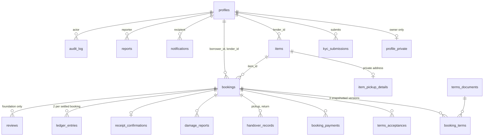

# Data model

**Owner: Srijan.** Matches the migrations up to `20261126010100` (Build 0.4) and `docs/api-contract.md` v1.0. Column notes list only what is not obvious from the SQL.

## Tables

| Table | Notes |
| --- | --- |
| `profiles` | `id` = auth user id. `role` (user, admin), `status` (active, suspended, deleted), `kyc_status` (none, pending, verified, rejected) are protected: clients cannot update them (column grants). `display_name` comes from sign-up metadata. |
| `profile_private` | Owner and admin only: `phone`, `area` (wire value such as `lalitpur`), `payout_details`. Client writes: update first, then insert (the client may not write `user_id` on an existing row). |
| `kyc_submissions` | Admin read only. One pending row per user. File paths live under `kyc/<user_id>/`. |
| `items` | `lender_id` is the Renter. `status` draft, active, paused. **`deleted_at` (Build 0.4)**: soft delete, set only by `delete_item`. `photo_paths` are paths in the public `item-photos` bucket. Publishing runs the `validate_listing` trigger (ID submitted, minimum declared value, category, condition, 1 to 5 existing photos). |
| `item_pickup_details` | Exact address and instructions. Owner and admin only; the Borrower gets it through the planned `get_booking_contact` after payment is verified. |
| `bookings` | 12 statuses, overlap constraint `prevent_double_booking`, immutable snapshot: rates, **`min_deposit_amount` (Build 0.4, default 0 for older rows)**, agreed rate, declared value, fee, deposit, commission, earning. Clients have no write access; every change is an RPC. |
| `app_settings` | Admin-only table. Public read through `get_public_settings()`. Keys: commission_rate, deposit_rate, **min_deposit_amount (Build 0.4)**, late_fee_multiplier, return_grace_hours, legal_action_period_days, request_expiry_hours, min_declared_value, auto_approve_orders. |
| `terms_documents`, `booking_terms`, `terms_acceptances` | Three audiences, one active published version each; published text is immutable; acceptance rows are immutable. |
| `booking_payments`, `handover_records`, `damage_reports`, `receipt_confirmations`, `ledger_entries` | Evidence and money records, see `docs/api-contract.md` section 2. |
| `notifications`, `reports`, `reviews`, `audit_log` | Recipient-only notifications (realtime), user reports, private review foundation, append-through-RPC audit. |

## Views and functions added in Build 0.4

- **View `public_items`**: the public card (active, not deleted, owner active with an ID submitted): item columns and `lender_first_name`. No exact address, phone or full name. Granted to anon and authenticated. It is an owner-run view on purpose (it joins `profiles`, which anon cannot read); the filter is inside the view.
- **`get_public_settings()`**: signed-in users; whitelisted keys only.
- **`delete_item(p_item_id)`**: owner only; refused with `ACTIVE_BOOKINGS_EXIST` while an accepted-or-later booking exists; pending requests are declined with reason `item_deleted`; the row is kept with `deleted_at`. Direct DELETE on `items` is no longer granted.
- **`rental_private.calculate_money(..., p_min_deposit)`**: `deposit = max(round_half_up(declared x rate), minimum)`. The 5-argument form stays and means "no minimum".
