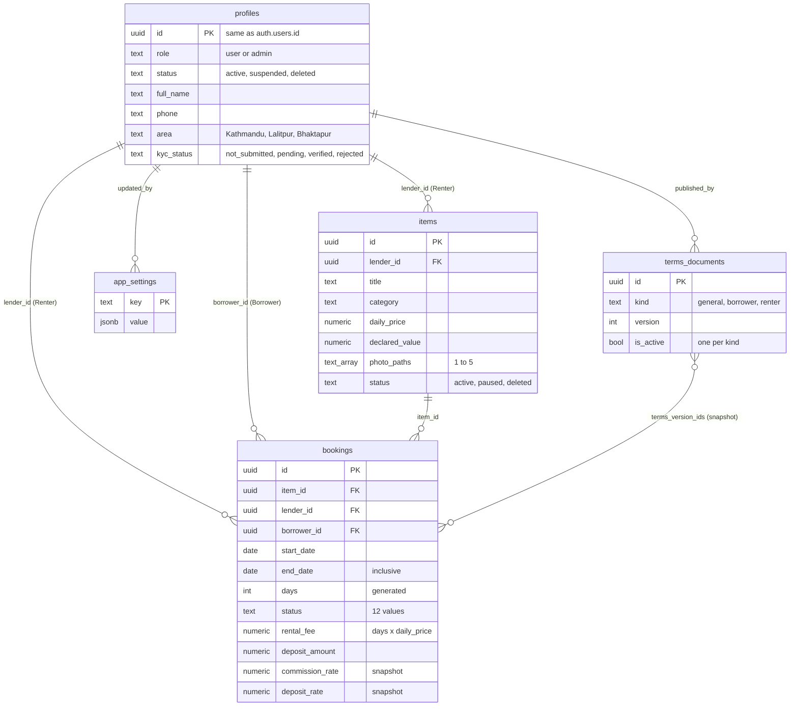

# Data model

**Owner: Srijan.** Status after Phase 0 (migrations `20261123120000` to `20261123120300`).

Tables built in Phase 0: `profiles`, `items`, `bookings`, `app_settings`, `terms_documents`.
Tables planned for later phases (from the plan): `booking_payments`, `terms_acceptances`, `handover_records`, `damage_reports`,
`ledger_entries`, `notifications`, `audit_log`, `reports`, `reviews`, `item_pickup_details`.

## Entity relationships

## Tables and design decisions

### profiles
One row per person, same `id` as `auth.users`. A trigger (`on_auth_user_created` calling `handle_new_user`) creates the row at sign-up from the
sign-up metadata (`full_name`, `phone`, `area`). It ignores `role`, `status` and `kyc_*` in the metadata, because users can edit their own metadata.
Bad input (an unknown area, a too-short phone) is dropped instead of rejected, because a failing trigger would block sign-up.

- **No foreign key to `auth.users`.** Account deletion is a soft delete (the row is anonymised, then the Edge Function removes the login). Bookings and the ledger must keep pointing at a profile, so the profile has to be able to outlive the login.
- Apps may write only `full_name`, `phone`, `area`. `role`, `status` and `kyc_*` change only through RPCs.

### items
A listing. `photo_paths` holds 1 to 5 paths in the public bucket. **Soft delete:** "delete" sets `status = 'deleted'` so old bookings keep their item.
The exact pickup address is not here; it will live in `item_pickup_details` and stay hidden until payment is verified. `area` is the public pickup area.

### bookings
One row per rental request. Status changes only through RPCs (apps have read-only access).

- **Double-booking prevention.** The exclusion constraint `bookings_no_double_booking` (a GiST index, needs `btree_gist`) rejects two rows with the same `item_id` and overlapping `daterange(start_date, end_date, '[]')` while both are in a date-blocking status. Because the database enforces it, two simultaneous accepts cannot both succeed. The loser gets SQLSTATE `23P01`.
- **`requested` does not block dates.** Many people may ask for the same days; the Renter's accept reserves them.
- **End date is inclusive.** `days = end_date - start_date + 1` (a generated column). The check `bookings_fee_matches_days` makes `rental_fee = days x daily_price`, mirroring `money.dart`.
- **Snapshot columns.** `daily_price`, `rental_fee`, `deposit_amount`, `commission_rate`, `deposit_rate`, `terms_version_ids` are copied when the request is made, so later price, setting or terms changes never alter an existing booking.
- A Renter cannot book their own item (`bookings_not_own_item`).

### app_settings
Admin-editable business settings, `key` plus a `jsonb` value, with checks on the value (rates between 0 and 1, `auto_approve_orders` boolean, expiry above 0).
Seeded: `commission_rate = 0.10`, `deposit_rate = 0.25`, `auto_approve_orders = true`, `request_expiry_hours = 48`.
**The two rates are placeholders** until the business notes confirm them.

### terms_documents
Three term sets, numbered versions, exactly one active version per kind (a partial unique index). A trigger makes published versions immutable (only `is_active` and `published_*` can change),
because bookings remember the version ids. Seeded v1 texts are templates marked "prototype, not legal advice" and name no specific law (honesty rules 5 and 8); a supervisor or legal adviser must review them before real use.

## Helper functions

| Function | Purpose |
| --- | --- |
| `set_updated_at()` | Trigger: keeps `updated_at` correct on every update. |
| `today_kathmandu()` | Today's date in `Asia/Kathmandu`; used for "no past dates" and blocked-date queries. |
| `handle_new_user()` | Sign-up trigger (see profiles). |
| `terms_documents_guard()` | Trigger that blocks editing or deleting a published terms version. |
| `is_admin()`, `is_active_user()` | Used inside RLS policies. |
| `get_item_blocked_dates(uuid)` | RPC: taken date ranges of an item, dates only. |
| `get_public_profiles(uuid[])` | RPC: name, area and verified badge of active users. |

## Migrations

| File | Contents |
| --- | --- |
| `20261123120000_core_schema.sql` | Extension, helpers, five tables, sign-up trigger, double-booking constraint, seeded settings and terms v1. |
| `20261123120100_security_rls_and_grants.sql` | RLS on, column grants, policies, `is_admin`, `is_active_user`, `get_public_profiles`, realtime on `bookings`. |
| `20261123120200_storage_buckets.sql` | Four buckets and their storage policies. |
| `20261123120300_rpc_item_blocked_dates.sql` | `get_item_blocked_dates`. |

Merged migrations are never edited; a change is a new file.

## Seed data

- `supabase/seed/seed.sql`: **local only.** Five fake users (password in the file header), ten Kathmandu Valley items, four bookings. Runs on `supabase db reset`.
- `supabase/seed/demo_seed.sql`: for the cloud projects. Creates no logins and contains no passwords; it attaches fake items and bookings to users you create in the dashboard.
